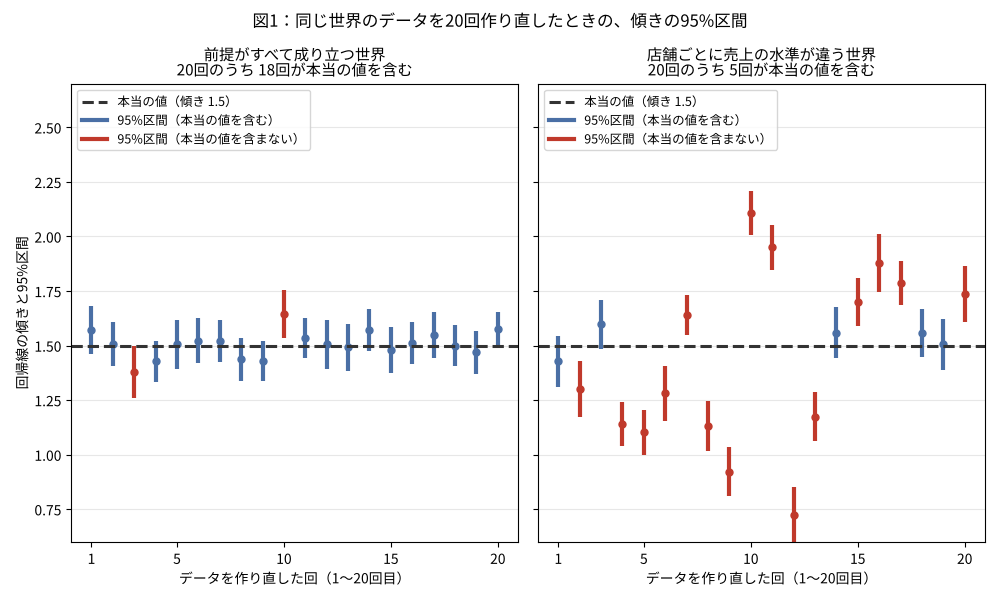
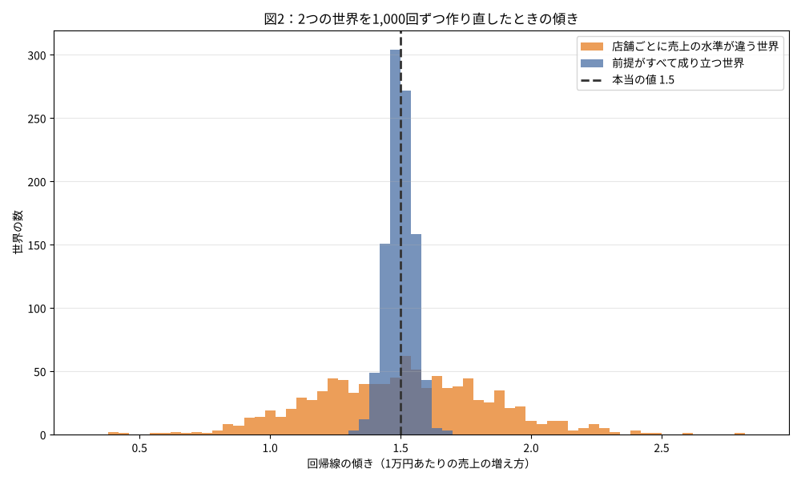

「データは2,080件あり、傾きは1.43、標準誤差は0.06。95%区間は1.31から1.55」。1本目の記事で作った仮想の世界に、店舗ごとの売上の水準の違いを1つ足すと、回帰分析はこういう結果を返します。ところが、同じ世界を1,000回作り直すと、この95%区間が本当の値1.5を含むのは27%だけです。

シリーズ「前提が崩れると何が起きるか（回帰分析編）」の3本目です。[前回](https://zenn.dev/haruguri/articles/regression-confounding-yearend)は、広告費を動かしているものが売上も動かす世界を作り、傾きが本当の値からずれる様子を見ました。鍵は、傾きのずれを表す項が $\mathrm{Cov}(x, d)/\mathrm{Var}(x)$ に近づき、0にならない、ということでした。今回は、傾きのずれは起きないまま、回帰が返す3つの数のうち**標準誤差**が当てにならなくなる様子を、式とシミュレーションで見ます。

式を減らした読み物版はサイトの[第3回「2,080件のデータで出た標準誤差は、どれだけ信じてよいのか」](https://www.interestat.jp/columns/tenpo-hyoujun-gosa)にあります。

## 世界を1か所だけ変える

[1本目](https://zenn.dev/haruguri/articles/regression-world-advertising)の世界は次の2本の式でした。

$$x_{st} = c_s + \varepsilon_{st},\quad y_{st} = 300 + 1.5\, x_{st} + e_{st}$$

ここに、店舗ごとに1つだけ値を持つ、売上の水準 $a_s$ を足します。

$$y_{st} = 300 + 1.5\, x_{st} + a_s + e_{st},\quad a_s \sim N(0,\ 40^2)$$

$a_s$ は店舗ごとに1回だけ引き、2年間変わりません。立地や商圏の違いで、広告とは関係なく売上が高い店舗と低い店舗がある、という設定です。予算の枠 $c_s$ は1本目と同じ一様分布から引くので、$a_s$ とは無関係です。前回の後半で扱った「枠を店舗の規模で配る世界」との違いは、この1点だけです。

```python
def generate(rng, store_level=False):
    n = S * T
    store = np.repeat(np.arange(S), T)
    c = rng.uniform(10, 100, S)
    x = np.clip(c[store] + rng.normal(0, 8, n), 5, None)
    e = rng.normal(0, SIG, n)
    a = rng.normal(0, 40, S) if store_level else np.zeros(S)
    y = ALPHA + BETA * x + a[store] + e
    return x, y, store
```

乱数は、枠、週のゆらぎ、誤差、店舗の水準の順に引きます。`default_rng(2026)` で作ると、広告費は1本目の世界とまったく同じ値になり、違いは売上に乗る $a_s$ だけです。

## 分散の式

1本目の記事で置いた式を、もう一度使います。

$$\hat\beta = \beta + \frac{\sum (x_i - \bar x)\, u_i}{\sum (x_i - \bar x)^2}$$

今回の世界では $u_{st} = a_s + e_{st}$ です。$a_s$ は $x$ と無関係なので、第2項の期待値は0で、傾きは偏りません。変わるのは第2項の分散です。$S_{xx} = \sum (x_i - \bar x)^2$ と書くと、次のようになります。

$$\mathrm{Var}(\hat\beta) = \frac{\sum_i \sum_j (x_i - \bar x)(x_j - \bar x)\, \mathrm{Cov}(u_i, u_j)}{S_{xx}^2}$$

誤差が互いに無関係なら、$i \ne j$ の項はすべて消えて $\sigma^2 / S_{xx}$ になります。回帰分析が返す標準誤差は、この形を前提に計算されています。今回の世界では、同じ店舗の2つの週が $a_s$ を共有しているので、$\mathrm{Cov}(u_{st}, u_{st'}) = 40^2$ が残ります。

$$\mathrm{Var}(\hat\beta) = \frac{60^2}{S_{xx}} + \frac{40^2 \sum_s \bigl(\sum_t (x_{st} - \bar x)\bigr)^2}{S_{xx}^2}$$

第2項は、店舗ごとに $(x_{st} - \bar x)$ を足してから2乗しています。同じ店舗の広告費は、どの週も枠 $c_s$ の近くにあるので、足し合わせると打ち消し合わずに積み上がります。

通常の標準誤差に対して分散が何倍になるかは、近似的に次の形で書けます。

$$1 + (T - 1)\, \rho_u\, \rho_x$$

$T$ は1店舗あたりの週の数、$\rho_u$ は同じ店舗の誤差どうしの相関、$\rho_x$ は同じ店舗の広告費どうしの相関です。大数の法則編の[第1本](https://zenn.dev/haruguri/articles/lln-without-independence-polling)で「設計効果」として置いた $1 + (m-1)\rho$ と同じ形で、違いは $\rho_x$ が掛かっている点です。誤差が店舗の中で似ていても、広告費が店舗の中で似ていなければ、傾きの分散は増えません。

この世界の値を入れてみます。

- $\rho_u = 40^2 / (40^2 + 60^2) \approx 0.308$
- $\rho_x = 675 / (675 + 8^2) \approx 0.913$
- 分散の倍率 $= 1 + 103 \times 0.308 \times 0.913 \approx 29.9$

標準誤差では $\sqrt{29.9} \approx 5.5$ 倍です。2,080件のデータは、互いに無関係なデータの $2{,}080 / 29.9 \approx 69$ 件分にあたります。

## 実験1：同じ世界のデータを20回作り直す

図1。同じ生成規則でデータを20回作り直し、それぞれで傾きと95%区間を求めました。左は1本目と同じ世界、右は店舗の水準を足した世界です。


*図1：同じ世界のデータを20回作り直したときの、傾きの95%区間。破線が本当の値*

左の世界では、20本のうち18本が本当の値を含んでいます。右の世界では5本です。区間の長さは左右でほとんど変わらず、変わったのは区間の位置の散らばりです。

1回目のデータ（図の左端）の傾きは1.427、標準誤差は0.060でした。1本目の世界の0.056とほとんど同じです。標準誤差は残差のばらつきから計算されるので、残差どうしが似ているかどうかは、計算のどこにも入りません。

## 実験2：同じ世界を1,000回作り直す

図2。1,000個の世界で出た傾きの分布です。


*図2：2つの世界を1,000回ずつ作り直したときの傾き。破線が本当の値*

店舗の水準を足した世界の傾きは平均1.506で、本当の値とほぼ一致します。偏りはありません。一方で、傾きの標準偏差は0.336で、各世界が見積もった標準誤差の平均0.060の5.6倍です。式から求めた倍率5.5とほぼ一致します。95%区間が本当の値を含んだ世界は26.7%でした。1本目の世界では94.1%です。

## 実験3：店舗でまとめて数え直す

分散の式の第2項を、残差から見積もる方法があります。店舗ごとに $(x_{st} - \bar x) \times$ 残差 を足してから2乗する、という計算で、クラスター頑健標準誤差と呼ばれます。この記事では「店舗でまとめた標準誤差」と書きます。

```python
def cluster_se(x, r):
    dx = x - x.mean()
    g = (dx * r).reshape(S, T).sum(axis=1)   # 店舗ごとに足す
    n = len(x)
    adj = S / (S - 1) * (n - 1) / (n - 2)
    return np.sqrt(adj * (g @ g)) / (dx @ dx)
```

| 世界 | 通常の標準誤差の的中率 | 店舗でまとめた標準誤差の的中率 | 店舗の平均20点の回帰の的中率 |
|---|---|---|---|
| 前提がすべて成り立つ | 94.1% | 92.6% | 94.9% |
| 店舗の水準が違う | 26.7% | 93.1% | 95.1% |

*店舗でまとめた標準誤差の区間は、自由度19のt分布の2.093を使った値*

店舗でまとめた標準誤差の平均は0.305で、傾きの実際の標準偏差0.336に近い値になります。的中率は93%まで戻りますが、95%には届きません。店舗が20しかないので、第2項の見積もり自体がブレるからです。店舗ごとの平均を取って20個の点にしてから回帰する方法では、的中率は95%になります。

どちらの方法も、数えているのは2,080件ではなく20店舗です。

## 検算

```
== 検算1：1つの世界 ==
前提がすべて成り立つ世界：傾き = 1.5727（標準誤差 0.0557）、95%区間 1.46〜1.68
店舗の水準が違う世界：傾き = 1.4271（標準誤差 0.0603）、95%区間 1.31〜1.55
店舗の水準が違う世界：残差の店舗ごとの平均 最小 -58.8、最大 44.2
広告費の分散：店舗の平均どうし 540／全体 577
店舗でまとめた標準誤差 = 0.2589、店舗ごとの平均20点の回帰：傾き 1.4178（標準誤差 0.2688）

== 検算2：分散の式 ==
誤差の店舗内相関 = 1600/5200 = 0.308、広告費の店舗内相関 = 675/739 = 0.913
分散の倍率 1 + (T−1)·ρu·ρx = 29.9、標準誤差の倍率 5.47、2,080件 ÷ 29.9 = 69件分
x を固定した本当の標準偏差：1つ目の世界 0.355、1,000個の平均 0.330

== 検算3：1,000個の世界 ==
前提がすべて成り立つ世界：傾きの平均 1.498、標準偏差 0.051、最小 1.32、最大 1.67、標準誤差の平均 0.050、95%区間の的中率 0.941
店舗の水準が違う世界：傾きの平均 1.506、標準偏差 0.336、最小 0.39、最大 2.80、標準誤差の平均 0.060、95%区間の的中率 0.267
隣り合う週が似る世界：傾きの平均 1.495、標準偏差 0.116、最小 1.12、最大 1.92、標準誤差の平均 0.050、95%区間の的中率 0.605
ばらつきが店舗で違う世界：傾きの平均 1.497、標準偏差 0.061、最小 1.29、最大 1.70、標準誤差の平均 0.055、95%区間の的中率 0.924

== 検算4：店舗でまとめて数え直す ==
前提がすべて成り立つ世界：店舗でまとめた標準誤差の平均 0.047、的中率 0.913（1.96）／0.926（t分布・自由度19の2.093）、店舗の平均20点の回帰の的中率 0.949
店舗の水準が違う世界：店舗でまとめた標準誤差の平均 0.305、的中率 0.912（1.96）／0.931（t分布・自由度19の2.093）、店舗の平均20点の回帰の的中率 0.951
隣り合う週が似る世界：店舗でまとめた標準誤差の平均 0.106、的中率 0.912（1.96）／0.927（t分布・自由度19の2.093）、店舗の平均20点の回帰の的中率 0.948
```

式から求めた標準誤差の倍率（5.5）と、1,000個の世界の値（0.336 ÷ 0.060 ＝ 5.6）がほぼ一致しています。式と数値の対応はこれで確かめられました。

## 何が言えなくなり、何がまだ言えるか

言えなくなるのは、「標準誤差が0.06なので、傾きは±0.12の範囲で確かだ」という読み方です。同じ店舗のデータが似ているとき、標準誤差は $\sqrt{1 + (T-1)\rho_u \rho_x}$ 倍だけ小さく出ます。「有意」や「95%区間」は、この数から出てくるので、同じだけ当てにならなくなります。

まだ言えるのは、傾きそのものです。傾きは偏っていません。前回の世界と違い、データを取り直せば、平均では本当の値に着きます。

データの中から分からないのは、どのデータどうしが似ているか、です。今回は店舗の番号がデータにあるので、店舗でまとめて数え直せました。まとまりを表す列がデータになければ、同じ計算はできません。

次の記事では、係数と標準誤差の前提は成り立ったままで、関係が直線でない世界を作ります。データの範囲の外側に回帰線を伸ばしたとき、予測がどこまで外れるかを見ます。

## 参考：隣り合う週が似ているとき

データが似る理由は、店舗の水準だけではありません。誤差が店舗の中で週をまたいで相関する世界（1つ前の週との相関が0.7で、離れるほど弱くなる）を作ると、的中率は60.5%でした。店舗の水準の世界ほど落ちないのは、相関が離れるほど消えていくからです。この世界でも、店舗でまとめた標準誤差の的中率は92.7%に戻ります。

## 参考：ばらつきが店舗で違うとき

標準誤差が置いている前提には、誤差が互いに無関係であることのほかに、誤差のばらつきがどのデータでも同じであることがあります。誤差の標準偏差を予算の枠に比例させた世界（枠の大きい店舗ほど売上がブレる）では、的中率は92.4%でした。当てにならなくはなりますが、同じ店舗のデータが似ている場合に比べると、効きは小さくなります。

## 参考：GLM では

この記事の話は、一般化線形モデル（GLM）でも同じ形で成り立ちます。同じまとまりのデータが似ていれば、標準誤差は小さく出ます。GLM にはもう1つ、線形回帰にはない前提があります。ポアソン回帰は「分散は平均と同じ」と仮定して標準誤差を計算するので、実際の分散が平均より大きいと（過分散）、データが互いに無関係でも標準誤差が小さく出ます。シリーズの最後に番外編で扱う予定です。

## 式を減らした版はサイトに

- [第3回「2,080件のデータで出た標準誤差は、どれだけ信じてよいのか」](https://www.interestat.jp/columns/tenpo-hyoujun-gosa)
- [単元「大数の法則」](https://www.interestat.jp/units/taisuu-housoku)

## 再現スクリプト

図と検算の出力を生成するスクリプト：[regression-clustered-errors.py](https://github.com/haruguri/zenn-content/blob/main/scripts/regression-clustered-errors.py)（NumPy・Matplotlib のみ）

このシリーズで使う仮想データは、シリーズ完結後に解説書を付けて GitHub で配布する予定です。

---

図とコードは筆者が設計し、生成と文章の整理にAIの支援を受けています。
