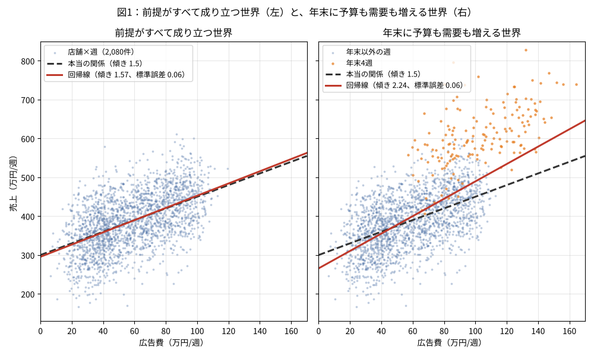
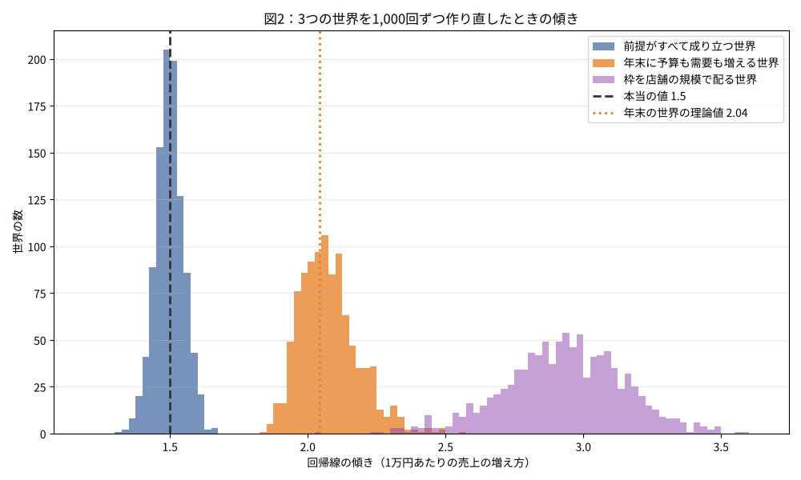

「広告費と売上を回帰したら傾きが2.24で、標準誤差も0.06と小さい。だから広告の効果は1万円あたり2.24万円」。前回の記事で作った仮想の世界に、年末商戦を1つ足すと、回帰分析はこういう結果を返します。本当の値は1.5のままです。

シリーズ「前提が崩れると何が起きるか（回帰分析編）」の2本目です。[前回](https://zenn.dev/haruguri/articles/regression-world-advertising)は、前提がすべて成り立つ世界を作り、回帰線が本当の関係を当て、標準誤差がそのブレを正しく見積もることを確かめました。鍵は、誤差が $x$ と無関係なら、傾きのずれを表す項の期待値が0になる、ということでした。今回は、その世界の生成規則を1か所だけ変えて、回帰が返す3つの数のうち**係数**が当てにならなくなる様子を、式とシミュレーションで見ます。

式を減らした読み物版はサイトの[第2回「年末に広告を増やしたら、売上も伸びた」](https://www.interestat.jp/columns/nenmatsu-koukoku-kouka)にあります。

## 世界を1か所だけ変える

前回の世界は次の2本の式でした。

$$x_{st} = c_s + \varepsilon_{st},\quad y_{st} = 300 + 1.5\, x_{st} + e_{st}$$

ここに、年末4週（年内の週番号48〜51）だけ値を持つ需要 $d_t$ を足します。

$$d_t = 150 \cdot \mathbf{1}[\text{年内の週番号} \ge 48]$$

$d_t$ は売上と広告費の両方に入ります。

$$x_{st} = c_s + \varepsilon_{st} + 0.3\, d_t,\quad y_{st} = 300 + 1.5\, x_{st} + d_t + e_{st}$$

売上には、広告とは関係なく年末だけ150万円が乗ります。広告費には、年末だけ45万円が乗ります。店舗が売上の伸びる時期に合わせて予算を積み増す、という行動です。本当の傾き1.5も、誤差 $e_{st}$ の作り方も、前回と同じです。

```python
def yearend(T):
    w = np.arange(T) % 52
    return np.where(w >= 48, 150.0, 0.0)

def generate(rng, confound=False):
    n = S * T
    store = np.repeat(np.arange(S), T)
    week = np.tile(np.arange(T), S)
    budget = rng.uniform(10, 100, S)[store]
    x = np.clip(budget + rng.normal(0, 8, n), 5, None)
    d = yearend(T) if confound else np.zeros(T)
    if confound:
        x = np.clip(x + 0.3 * d[week], 5, None)
    y = ALPHA + BETA * x + d[week] + rng.normal(0, SIG, n)
    return x, y
```

乱数を引く順番は前回と同じにしてあります。`default_rng(2026)` で作ると、年末以外の週は前回の世界とまったく同じ値になり、違いは年末4週の上乗せだけです。

## 偏りの式

前回の記事で置いた式を、もう一度使います。

$$\hat\beta = \beta + \frac{\sum (x_i - \bar x)\, u_i}{\sum (x_i - \bar x)^2}$$

分析者は単回帰しか当てないので、直線で説明できない部分 $u_i$ はすべて誤差として扱われます。今回の世界では $u_i = d_i + e_i$ で、$d_i$ は $x_i$ と無関係ではありません。データが十分多いとき、第2項は

$$\frac{\mathrm{Cov}(x, d)}{\mathrm{Var}(x)}$$

に近づき、これが傾きの**偏り**になります。前回の世界では $d = 0$ なので、この項は0でした。

この世界の値を入れてみます。1年52週のうち4週で $d = 150$ なので、$p = 4/52$ として次のようになります。

- $\mathrm{Var}(d) = 150^2 \, p(1-p) \approx 1{,}598$
- $\mathrm{Cov}(x, d) = 0.3 \, \mathrm{Var}(d) \approx 479$
- $\mathrm{Var}(x) = \mathrm{Var}(c) + 8^2 + 0.3^2 \, \mathrm{Var}(d) \approx 675 + 64 + 144 = 883$

ここで $\mathrm{Var}(c) = 90^2/12 = 675$ は一様分布 $U(10, 100)$ の分散です。偏りは $479/883 \approx 0.54$ で、傾きの理論値は $1.5 + 0.54 \approx 2.04$ になります。

式の形から、偏りが大きくなる条件が読めます。分子は「広告費が需要にどれだけ連動しているか」、分母は「広告費がそれ以外の理由でどれだけ散っているか」です。店舗ごとの枠の差が小さい世界ほど、同じ連動でも偏りは大きくなります。

## 実験1：1つの世界に直線を引く

図1。左は前回と同じ世界、右は年末商戦を足した世界です。右の図では年末4週の点をオレンジ色にしてあります。


*図1：前提がすべて成り立つ世界（左）と、年末に予算も需要も増える世界（右）*

右の世界の傾きは2.238、標準誤差は0.058でした。理論値2.04より大きいのは、この世界で引いた20店舗の枠のばらつきが小さめだったからです。この世界の標本で計算すると $\mathrm{Cov}(x, d)/\mathrm{Var}(x) = 482/722 \approx 0.67$ で、$\mathrm{Var}(x)$ が理論値の883より小さく、偏りが大きく出ています。

標準誤差は前回の0.056とほとんど変わりません。標準誤差は残差のばらつきから計算されますが、最小二乗の残差は、作り方の上で必ず $x$ と無相関になります。$u_i$ のうち $x$ と連動している部分は傾きに吸い込まれ、残差には残りません。そのため、偏りがあるかどうかは、標準誤差にはまったく表れません。

## 実験2：同じ世界を1,000回作り直す

同じ生成規則で世界を1,000個作り、それぞれで傾きを推定します。比較のため、前回の世界と、もう1つの交絡の世界も並べます。もう1つの世界は、予算の枠を店舗の規模に応じて配る世界です。店舗の規模 $a_s \sim N(0, 40^2)$ が売上に乗り、枠を $c_s = 55 + 0.5\, a_s + N(0, 10^2)$ で決めます（10〜100に収めます）。年末商戦は入れません。

図2。1,000個の世界で出た傾きの分布です。


*図2：3つの世界を1,000回ずつ作り直したときの傾き。破線が本当の値、点線が年末の世界の理論値*

年末の世界の傾きは平均2.077で、理論値2.04にほぼ一致します。1,000個のうち最も小さい値でも1.84で、95%区間が本当の値1.5を含んだ世界は1つもありませんでした。

店舗の規模で枠を配る世界は、さらに大きくずれます。偏りの式に入れると、$\mathrm{Cov}(x, a) = 0.5 \cdot 40^2 = 800$、$\mathrm{Var}(x) = 0.25 \cdot 40^2 + 10^2 + 8^2 = 564$ で、偏りは $800/564 \approx 1.42$、理論値は2.92です。シミュレーションの平均は2.931でした。この世界では広告費の差のほとんどが店舗どうしの差なので、分母が小さく、分子が大きくなります。

もう1つ見ておきたいのは、年末の世界の傾きの標準偏差が0.106で、各世界が見積もった標準誤差の平均0.053の2倍あることです。1,000個の世界で枠 $c_s$ を毎回引き直しているため、$\mathrm{Var}(x)$ が世界ごとに変わり、偏りの大きさ自体が世界ごとに揺れるからです。1つの世界の中から見える標準誤差は、この揺れを知りません。

## 実験3：傾きを間違えた線で、売上を予測する

同じ仕組みで新しく2年分のデータを作り（`default_rng(2027)`）、その売上を2本の線で予測します。1本は実験1の回帰線（傾き2.238）、もう1本は本当の関係の線 $300 + 1.5x$ です。

| 週 | 回帰線の外れ | 本当の関係の線の外れ |
|---|---|---|
| 全体 | 70.4 | 72.8 |
| 年末以外 | 62.9 | 59.8 |
| 年末4週 | 129.7 | 161.1 |

*外れは「実際の売上 − 予測」の2乗平均の平方根（万円）*

全体では回帰線の方が当たります。最小二乗の直線は、手元のデータで2乗誤差を最小にする直線なので、同じ仕組みで作られた新しいデータでも、他の直線より当たりやすいからです。本当の関係の線も例外ではありません。

内訳を見ると、年末以外の週では本当の関係の線の方が当たっていて、59.8は誤差の標準偏差60とほぼ同じです。回帰線は傾きが急な分、広告費の少ない週を低めに（40万円未満の週で平均21万円低い）、多い週を高めに（70万円以上の週で平均23万円高い）予測しています。回帰線が全体で勝つのは、年末4週の外れを31万円ほど小さくした分が、年末以外の週で増えた外れを上回るからです。

つまり、係数の前提が崩れても、「広告費がこの値のときの売上」を当てる道具としての回帰線は、2乗誤差の意味では直線の中で最善のままです。崩れるのは、「広告費を1万円増やしたら売上はいくら増えるか」という読み方の方です。この2つの問いは、式の上では同じ係数を使いますが、寄りかかっている前提が違います。

## 検算

```
== 検算1：1つの世界 ==
前提がすべて成り立つ世界：傾き = 1.5727（標準誤差 0.0557）
年末の世界：傾き = 2.2376（標準誤差 0.0576）、切片 = 265.75
年末4週の平均：広告費 103.4／それ以外 58.1、売上 607.3／それ以外 386.7

== 検算2：偏りの式 ==
Var(d) = 1597.6、Cov(x, d) = 479.3、Var(x) = 882.8
偏りの理論値 Cov(x, d)/Var(x) = 0.543 → 傾きの理論値 2.043
この世界の標本値：Cov(x, d)/Var(x) = 481.8/722.3 = 0.667

== 検算3：1,000個の世界 ==
前提がすべて成り立つ世界：傾きの平均 1.498、標準偏差 0.051、最小 1.32、最大 1.67、標準誤差の平均 0.050、95%区間の的中率 0.941
年末の世界：傾きの平均 2.077、標準偏差 0.106、最小 1.84、最大 2.57、標準誤差の平均 0.053、95%区間の的中率 0.000
店舗の規模で枠を配る世界：傾きの平均 2.931、標準偏差 0.219、最小 2.05、最大 3.60、標準誤差の平均 0.064、95%区間の的中率 0.000
店舗の世界の理論値：1.5 + 1.418 = 2.918

== 検算4：年末を知っていれば ==
年末の印を説明変数に入れた重回帰：広告費の傾き = 1.5726（標準誤差 0.0557）、年末の係数 = 149.5
年末4週を除いた単回帰：傾き = 1.5605（標準誤差 0.0578）

== 検算5：新しい2年分での予測 ==
全体：外れの大きさ（2乗平均の平方根） 回帰線 70.4／本当の関係の線 72.8
年末以外：外れの大きさ（2乗平均の平方根） 回帰線 62.9／本当の関係の線 59.8
年末4週：外れの大きさ（2乗平均の平方根） 回帰線 129.7／本当の関係の線 161.1
年末以外・40未満（695件）：実際 − 予測の平均 回帰線 +21.1／本当の関係の線 +1.1
年末以外・40〜70（701件）：実際 − 予測の平均 回帰線 -6.0／本当の関係の線 +1.2
年末以外・70以上（524件）：実際 − 予測の平均 回帰線 -23.3／本当の関係の線 +4.3
年末4週（160件）：実際 − 予測の平均 回帰線 +113.8／本当の関係の線 +149.6
```

偏りの理論値（2.04・2.92）と1,000個の世界の平均（2.08・2.93）がほぼ一致しています。式と数値の対応はこれで確かめられました。

## 何が言えなくなり、何がまだ言えるか

言えなくなるのは、「傾きは広告の効果だ」という読み方です。広告費を動かしているものが売上も動かしているとき、傾きは $\mathrm{Cov}(x, d)/\mathrm{Var}(x)$ だけずれ、そのずれは標準誤差にも、データを増やすことにも表れません。

まだ言えるのは、「広告費がこの値のとき、売上はこのくらい」という予測です。予測の道具としての回帰線は、2乗誤差の意味で直線の中の最善のまま崩れていません。

データの中から分からないのは、現実のデータで広告費を動かしているものが何か、です。図1の右でオレンジ色に塗れたのは生成規則を知っているからで、現実のデータには色が付いていません。

次の記事では、係数の前提は成り立ったままで、誤差が独立でなくなる世界を作ります。前回の記事で94.1%だった95%区間の的中率が、どこまで落ちるかを見ます。

## 参考：年末を知っていれば、戻せる

この世界で何が広告費を動かしているかを知っていれば、傾きは戻せます。年末4週に1、それ以外に0を付けた変数を説明変数に加えて重回帰すると、広告費の傾きは1.5726、年末の係数は149.5でした。広告費の傾きは前回の世界の値（1.5727）とほぼ同じです。年末4週を除いて単回帰しても、傾きは1.5605に戻ります。

ただし、これは**答えを知っているから入れられた変数**です。現実のデータで同じことをするには、広告費を動かしているもの（ここでは年末の需要）を、自分の言葉で言えなければなりません。言えたものは入れられますが、言えなかったものは入れられず、その分の偏りは残ります。

## 参考：GLM では

この記事の話は、一般化線形モデル（GLM）でも、リンク関数の内側でそのまま成り立ちます。広告費を動かしているものが目的変数も動かしていれば、係数はずれます。GLM にはもう1つ、線形回帰にはない現象があります。ロジスティック回帰のオッズ比は、$x$ とは無関係でも目的変数に効いている変数を落とすと、値が変わります（非崩壊性）。交絡がなくても係数が変わるので、「変数を足したら係数が変わった、だから交絡だ」という読み方は、GLM では成り立たないことがあります。シリーズの最後に番外編で扱う予定です。

## 式を減らした版はサイトに

- [第2回「年末に広告を増やしたら、売上も伸びた」](https://www.interestat.jp/columns/nenmatsu-koukoku-kouka)
- [単元「擬相関と偏相関」](https://www.interestat.jp/units/gi-souakan-hensouakan)

## 再現スクリプト

図と検算の出力を生成するスクリプト：[regression-confounding-yearend.py](https://github.com/haruguri/zenn-content/blob/main/scripts/regression-confounding-yearend.py)（NumPy・Matplotlib のみ）

このシリーズで使う仮想データは、シリーズ完結後に解説書を付けて GitHub で配布する予定です。

---

図とコードは筆者が設計し、生成と文章の整理にAIの支援を受けています。
