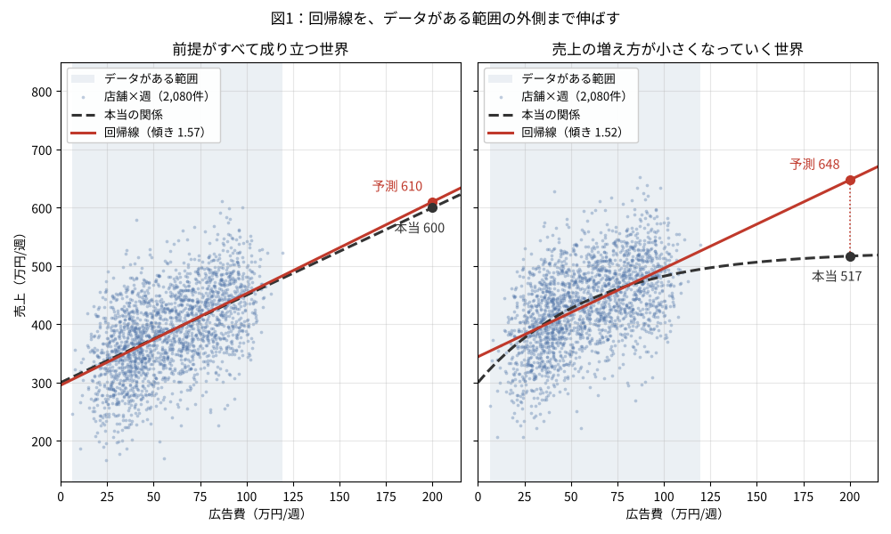
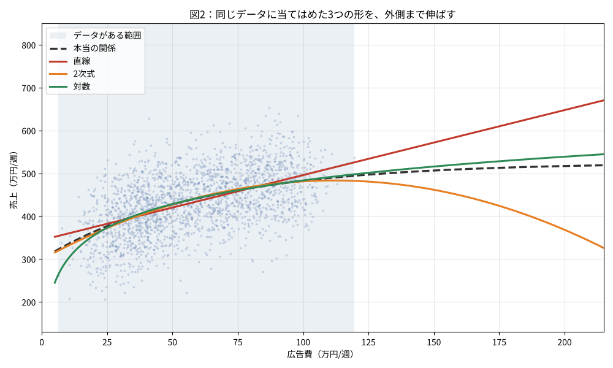

「傾きは1.52、標準誤差は0.06。広告費を200万円にしたときの売上の予測は648万円」。1本目の記事で作った仮想の世界で、売上の増え方を少しずつ小さくしていくと、回帰分析はこういう結果を返します。本当の値は517万円です。同じ世界を1,000回作り直しても、予測が604万円を下回ることはありません。

シリーズ「前提が崩れると何が起きるか（回帰分析編）」の4本目です。[前回](https://zenn.dev/haruguri/articles/regression-clustered-errors)は、店舗ごとに売上の水準が違う世界を作り、標準誤差が小さく出る様子を見ました。鍵は、傾きの分散が $1 + (T-1)\rho_u\rho_x$ 倍になるのに、標準誤差の計算はそれを知らない、ということでした。今回は、係数と標準誤差の前提は成り立ったまま、回帰が返す3つの数のうち**予測値**が当てにならなくなる様子を、式とシミュレーションで見ます。

式を減らした読み物版はサイトの[第4回「広告費を倍にしたら売上はどうなるか——回帰線を外側に伸ばしてよいのか」](https://www.interestat.jp/columns/koukokuhi-bai-yosoku)にあります。

## 世界を1か所だけ変える

[1本目](https://zenn.dev/haruguri/articles/regression-world-advertising)の世界は次の2本の式でした。

$$x_{st} = c_s + \varepsilon_{st},\quad y_{st} = 300 + 1.5\, x_{st} + e_{st}$$

今回は、売上の式の $1.5\,x$ を、上限のある曲線に置き換えます。

$$y_{st} = m(x_{st}) + e_{st},\quad m(x) = 300 + 225\,\bigl(1 - e^{-x/60}\bigr)$$

広告費を1万円増やしたときの売上の増え方は $m'(x) = 3.75\, e^{-x/60}$ です。広告費が10万円のあたりで3.17、55万円で1.50、100万円で0.71、200万円で0.13と、広告費が大きいほど小さくなります。予算の枠の中央（55万円）での増え方が、1本目の世界の1.5と同じになるように決めてあります。

```python
def m(x, diminishing=True):
    return ALPHA + CAP * (1 - np.exp(-x / TAU)) if diminishing else ALPHA + BETA * x

def generate(rng, diminishing=False):
    n = S * T
    store = np.repeat(np.arange(S), T)
    c = rng.uniform(10, 100, S)
    x = np.clip(c[store] + rng.normal(0, 8, n), 5, None)
    e = rng.normal(0, SIG, n)
    return x, m(x, diminishing) + e
```

予算の枠 $c_s$ は売上と無関係で、誤差 $e_{st}$ は互いに独立です。前々回と前回で崩した2つの前提は、どちらも成り立っています。`default_rng(2026)` で作ると、広告費と誤差は1本目の世界とまったく同じ値になり、違いは $m(x)$ の形だけです。

## 直線は何に近づくか

関係が直線でないときも、最小二乗の計算は直線を1本返します。データを増やしたとき、この直線の傾きと切片は次の値に近づきます。

$$\beta^* = \frac{\mathrm{Cov}\bigl(x,\ m(x)\bigr)}{\mathrm{Var}(x)},\qquad \alpha^* = E[m(x)] - \beta^*\, E[x]$$

これは、広告費の分布の上で $m(x)$ に最も近い直線です。この世界の値を入れると $\alpha^* \approx 338.0$、$\beta^* \approx 1.593$ になります。

広告費 $x_0$ での予測のずれは、この直線と曲線の差です。

$$(\alpha^* + \beta^* x_0) - m(x_0)$$

| 広告費 | 20万円 | 55万円 | 100万円 | 150万円 | 200万円 |
|---|---|---|---|---|---|
| 直線と曲線の差 | +6 | −9 | +15 | +70 | +140 |

データがある範囲（広告費が6万円から120万円）では、差は10万円前後です。直線は、この範囲で差が小さくなるように決まるからです。範囲の外側は、直線を決める計算に入っていません。差は150万円で70、200万円で140と、離れるほど大きくなります。

この差は、データを増やしても小さくなりません。前々回の傾きのずれと同じく、偏りです。

## 実験1：直線を外側に伸ばす

図1。左は1本目と同じ世界、右は今回の世界です。色を付けた帯がデータのある範囲で、回帰線と本当の関係を200万円まで伸ばしてあります。


*図1：回帰線を、データがある範囲の外側まで伸ばす。破線が本当の関係*

左の世界では、200万円の予測は610、本当の値は600です。右の世界では、予測は648、本当の値は517で、131の差があります。

右の世界の回帰の結果は、傾き1.516、標準誤差0.056です。1本目の世界は1.573と0.056でした。結果の表を見比べても、2つの世界の違いは分かりません。

## 実験2：同じ世界を1,000回作り直す

1,000個の世界で、55万円・100万円・200万円の予測を求めました。

| 広告費 | 予測の平均 | 予測の最小〜最大 | 本当の値 | 新しい1週の売上が95%予測区間に入った割合 |
|---|---|---|---|---|
| 55万円 | 425.9 | 418〜434 | 435.0 | 95.1% |
| 100万円 | 497.5 | 485〜517 | 482.5 | 93.6% |
| 200万円 | 656.7 | 604〜712 | 517.0 | 38.0% |

200万円の予測は、最も低い世界でも604で、本当の値517に届いた世界はありません。

右端の列は、回帰分析が予測値に付ける幅の話です。新しい1件の観測に対する95%予測区間は、次の式で計算されます。

$$\hat y_0 \pm 1.96\, s\,\sqrt{1 + \frac{1}{n} + \frac{(x_0 - \bar x)^2}{S_{xx}}}$$

$x_0$ が $\bar x$ から離れるほど幅は広がりますが、この世界では半幅が55万円で±119、200万円で±120と、ほとんど変わりません。式の第3項は、直線の傾きの推定のブレを表していて、関係が直線であることは前提にしています。200万円での偏り（140）は、どの項にも入りません。そのため、範囲の内側では95%前後を保つ区間が、200万円では38%しか当たりません。

## 実験3：曲がりは分かるが、外側は決まらない

関係が曲がっていること自体は、データから確かめられます。回帰線からの残差を広告費の水準ごとに平均すると、両端で負、中央で正になります。

| 広告費 | 25万円未満 | 25〜40 | 40〜70 | 70〜100 | 100万円以上 |
|---|---|---|---|---|---|
| 残差の平均 | −17.7 | −1.8 | +7.1 | −0.9 | −21.8 |

2次の項を足した回帰では、2次の係数の t 値は−6.1です。

そこで、同じデータに3つの形を当てはめて、外側まで伸ばしてみます。


*図2：同じデータに当てはめた3つの形（直線・2次式・対数）を、外側まで伸ばす。破線が本当の関係*

| 当てはめた形 | 残差の標準偏差 | 100万円の予測 | 200万円の予測 |
|---|---|---|---|
| 直線 | 61.49 | 496 | 648 |
| 2次式 | 60.96 | 481 | 368 |
| 対数 | 61.00 | 484 | 539 |
| 本当の関係 | 60.96 | 483 | 517 |

データがある範囲では、3つの形の残差の標準偏差は61前後で、ほとんど区別がつきません。2次式と対数は、100万円の予測でも本当の値とほぼ一致します。200万円では、2次式は368、対数は539、直線は648です。2次式は、範囲の外側で売上が下がっていく形になります。

範囲の内側のデータは、範囲の内側の形しか決めません。外側の値は、どの形を選んだかで決まります。

## 検算

```
== 検算1：本当の関係 ==
1万円あたりの増え方 3.75·exp(−x/60)：10万円で 3.17、55万円で 1.50、100万円で 0.71、200万円で 0.13
直線の極限（最良の直線近似）：切片 338.0、傾き 1.593
極限の直線と本当の関係の差：20万円で +6、55万円で -9、100万円で +15、150万円で +70、200万円で +140

== 検算2：1つの世界 ==
前提がすべて成り立つ世界：切片 295.4、傾き 1.5727（標準誤差 0.0557）、200万円の予測 610（本当 600）
増え方が小さくなる世界：切片 344.3、傾き 1.5164（標準誤差 0.0561）、広告費の範囲 6.4〜119.5
  20万円：直線 375、本当 364、差 +11、95%予測区間の半幅 ±121
  55万円：直線 428、本当 435、差 -7、95%予測区間の半幅 ±121
  100万円：直線 496、本当 483、差 +13、95%予測区間の半幅 ±121
  120万円：直線 526、本当 495、差 +32、95%予測区間の半幅 ±121
  150万円：直線 572、本当 507、差 +65、95%予測区間の半幅 ±121
  200万円：直線 648、本当 517、差 +131、95%予測区間の半幅 ±122
データ上の増え方の平均 1.537

== 検算3：1,000個の世界 ==
傾き：平均 1.591、標準偏差 0.107、標準誤差の平均 0.051
55万円の予測：平均 425.9、最小 418、最大 434、本当 435.0、新しい1週の売上が95%予測区間に入った割合 0.951（半幅の平均 ±119）
100万円の予測：平均 497.5、最小 485、最大 517、本当 482.5、新しい1週の売上が95%予測区間に入った割合 0.936（半幅の平均 ±119）
200万円の予測：平均 656.7、最小 604、最大 712、本当 517.0、新しい1週の売上が95%予測区間に入った割合 0.380（半幅の平均 ±120）

== 検算4：曲がりはデータから分かるか ==
残差の平均 0〜25万円：-17.7（142件）
残差の平均 25〜40万円：-1.8（447件）
残差の平均 40〜70万円：+7.1（778件）
残差の平均 70〜100万円：-0.9（641件）
残差の平均 100万円以上：-21.8（72件）
2次の項の t 値 -6.1

== 検算5：3つの形 ==
残差の標準偏差：直線 61.49、2次式 60.96、対数 61.00（本当の関係からのずれ 60.96）
100万円の予測：直線 496、2次式 481、対数 484、本当 483
150万円の予測：直線 572、2次式 462、対数 516、本当 507
200万円の予測：直線 648、2次式 368、対数 539、本当 517
1,000個の世界の200万円の予測：2次式 平均 394（262〜531）、対数 平均 522（501〜547）
```

式から求めた傾きの極限（1.593）と、1,000個の世界の傾きの平均（1.591）が一致しています。200万円での差も、式の値（+140）と1,000個の世界の平均（656.7 − 517.0 ＝ +139.7）が一致しました。

## 何が言えなくなり、何がまだ言えるか

言えなくなるのは、データがある範囲の外側の予測です。200万円の予測648は、「関係は200万円まで同じ直線で続く」という仮定から出た値で、その仮定を確かめるデータは1件もありません。予測区間も同じ仮定の上で計算されるので、外側では当たりません。

まだ言えるのは、範囲の内側の予測です。直線と曲線の差は10万円前後で、予測区間も95%前後を保ちます。傾き1.52も、データ上の増え方の平均（1.54）としては合っています。

データの中から分からないのは、範囲の外側で関係がどう続くか、です。曲がっていることは残差から分かりますが、直線・2次式・対数のどれが外側で正しいかは、範囲の内側の当てはまりでは決まりません。

本編の計算編は、この記事で終わりです。サイトの第5回で、ここまでの3つの確認（広告費を動かしているもの、互いに無関係なまとまりの数、データがある範囲）を、回帰の結果を使う前の手順としてまとめます。

## 参考：傾きの標準誤差は正しいのか

検算3で、1,000個の世界の傾きの標準偏差は0.107、標準誤差の平均は0.051でした。前回と同じことが起きているように見えますが、理由は別です。

$\beta^*$ は、広告費の分布の上での最良の直線の傾きです。世界を作り直すたびに20店舗の枠を引き直すので、枠の小さい店舗が多い世界では $\beta^*$ が大きく、枠の大きい店舗が多い世界では小さくなります。0.107には、この「狙っている値そのものの動き」が入っています。広告費を固定して誤差だけを引き直せば、傾きのブレは標準誤差とほぼ一致します。

関係が直線でないとき、傾きは「この広告費の並びでの平均的な増え方」を表します。広告費の並びが変われば、同じ世界でも傾きは変わります。

## 参考：GLM では

一般化線形モデル（GLM）では、直線にあたるものが「リンク関数を通した線形予測子」になります。対数リンクなら、説明変数が1増えるごとに平均が一定の倍率で増える、という形です。データがある範囲の外側の予測がこの形の仮定に支えられている点は、線形回帰と変わりません。倍率で増える形は外側で急に大きくなるので、伸ばしたときの外れ方は直線より大きくなりえます。シリーズの最後に番外編で扱う予定です。

## 式を減らした版はサイトに

- [第4回「広告費を倍にしたら売上はどうなるか——回帰線を外側に伸ばしてよいのか」](https://www.interestat.jp/columns/koukokuhi-bai-yosoku)
- [単元「単回帰と予測」](https://www.interestat.jp/units/tan-kaiki)

## 再現スクリプト

図と検算の出力を生成するスクリプト：[regression-extrapolation-diminishing.py](https://github.com/haruguri/zenn-content/blob/main/scripts/regression-extrapolation-diminishing.py)（NumPy・Matplotlib のみ）

このシリーズで使う仮想データは、シリーズ完結後に解説書を付けて GitHub で配布する予定です。

---

図とコードは筆者が設計し、生成と文章の整理にAIの支援を受けています。
