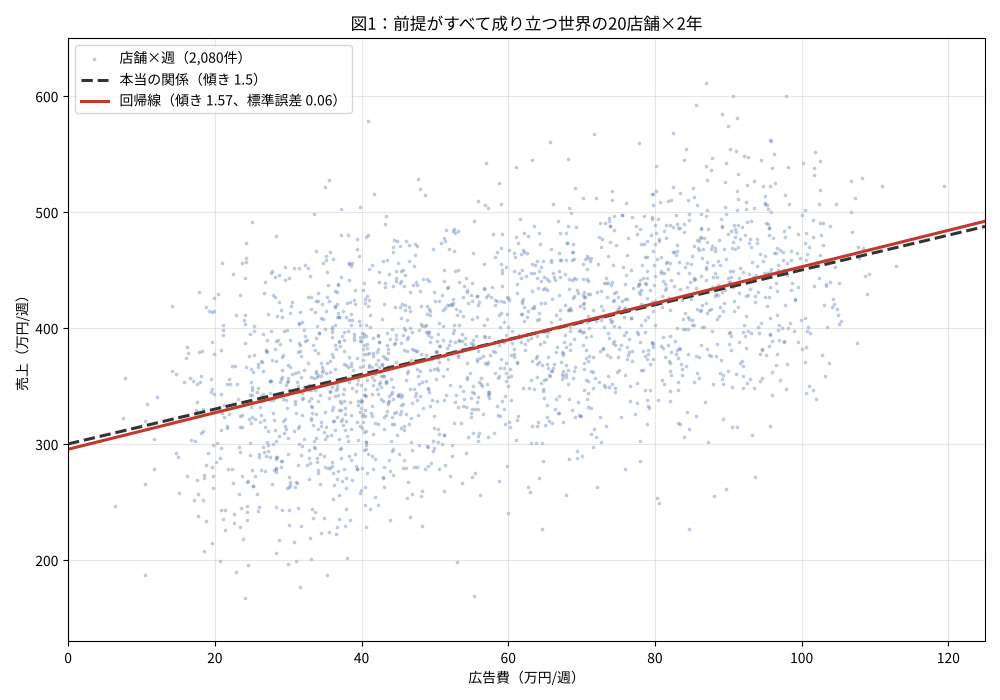
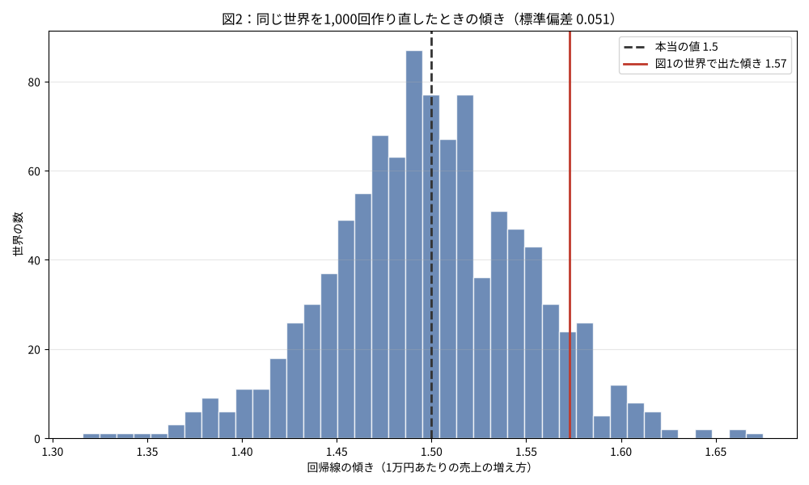

「広告費と売上を回帰したら傾きが1.57で、標準誤差も0.06と小さい。だから広告費を1万円増やせば売上は1.57万円増える」。回帰分析の結果は、だいたいこう読まれます。

この読み方が正しいのはどういうときで、どこから当てにならなくなるのかを、シリーズ「前提が崩れると何が起きるか（回帰分析編）」で見ていきます。この記事はその準備です。**前提がすべて成り立つ仮想の世界**を1つ作り、そこで回帰線が正しく働いている姿を確かめます。以降の記事では、この世界のどこかを1つずつ変えて、何が起きるかを見ます。

大数の法則編（[第1本](https://zenn.dev/haruguri/articles/lln-without-independence-polling)〜第4本）では回ごとに別の例を使いましたが、回帰分析編は全回を通して同じ仮想データを使います。生成の仕組みを先に公開しておくのは、後の記事で「どこを変えたか」を正確に言うためでもあります。

式を減らした読み物版はサイトの[第1回「広告費を1万円増やすと、売上はいくら増えるのか」](https://www.interestat.jp/columns/koukokuhi-kaiki)にあります。

## 仮想の世界の作り方

架空の小売チェーンを考えます。店舗20、週104（2年）、合計2,080行で、各行に広告費 $x$（万円/週）と売上 $y$（万円/週）があります。

**広告費**は店舗ごとに予算枠を持たせます。店舗 $s$ の枠 $c_s$ を一様分布 $U(10, 100)$ から1回引き、週ごとに標準偏差8のゆらぎを足します。

$$x_{st} = c_s + \varepsilon_{st},\quad \varepsilon_{st} \sim N(0, 8^2)$$

店舗ごとに枠を固定するのは、現実の予算の決まり方に寄せるためと、後の記事（標準誤差の回）で効いてくる構造を最初から入れておくためです。この記事の範囲では、この構造は何も起こしません。

**売上**は本当の関係を直線で決め、誤差を足します。

$$y_{st} = 300 + 1.5\, x_{st} + e_{st},\quad e_{st} \sim N(0, 60^2)$$

本当の傾きは1.5、つまり広告費1万円あたり売上1.5万円です。誤差 $e_{st}$ は互いに独立で、分散は一定で、$x$ とは無関係に引きます。これが「前提がすべて成り立つ」の中身で、具体的には次の3つが満たされています。

1. $x$ と誤差が無関係（係数が寄りかかる前提）
2. 誤差が互いに独立で、分散が一定（標準誤差が寄りかかる前提）
3. 本当の関係が直線で、予測は観測した範囲の内側で行う（予測値が寄りかかる前提）

後の記事ではこの3つを1つずつ外します。外し方は各記事で書きます。

```python
S, T = 20, 104
ALPHA, BETA, SIG = 300.0, 1.5, 60.0

def generate(rng):
    n = S * T
    store = np.repeat(np.arange(S), T)
    budget = rng.uniform(10, 100, S)[store]
    x = np.clip(budget + rng.normal(0, 8, n), 5, None)
    y = ALPHA + BETA * x + rng.normal(0, SIG, n)
    return x, y
```

## 1本の式と、2つの前提

単回帰の傾きの推定値は、次のように書けます。

$$\hat\beta = \beta + \frac{\sum (x_i - \bar x)\, e_i}{\sum (x_i - \bar x)^2}$$

第2項が、推定値と本当の値のずれです。誤差 $e_i$ が $x$ と無関係なら第2項の期待値は0で、傾きは平均的に本当の値を当てます。誤差が独立で分散 $\sigma^2$ なら、第2項の分散は

$$\mathrm{Var}(\hat\beta) = \frac{\sigma^2}{\sum (x_i - \bar x)^2}$$

で、この平方根が**標準誤差**です。分母は「$x$ がどれだけ散っているか」の総量で、件数が増えるほど大きくなります。分子は誤差の分散で、点が直線のまわりにどれだけ散っているかです。点が広く散っていても、$x$ が十分に散っていれば標準誤差は小さくなります。当てはまりの良さ（$R^2$）と傾きの精度は同じものではありません。この世界では $R^2$ は0.28しかありませんが、傾きは小数第2位まで決まります。

この式の分子と分母は、後の記事でそれぞれ狙われます。$x$ と誤差が無関係でなくなると1つ目の式の第2項が消えなくなり（係数の回）、誤差が独立でなくなると2つ目の式の分子が $\sigma^2$ では済まなくなります（標準誤差の回）。

## 実験1：1つの世界に直線を引く

`default_rng(2026)` で世界を1つ作り、最小二乗で直線を引きます。サイト第1回の図1と同じ乱数の並びなので、同じ図になります。

図1。点は2,080件の店舗×週、破線が本当の関係、実線が回帰線です。


*図1：前提がすべて成り立つ世界の20店舗×2年*

傾きは1.573、標準誤差は0.056で、本当の値1.5は95%区間 [1.464, 1.682] の内側にあります。点は直線のまわりに上下200万円近く散っていますが、直線の位置は本当の関係からほとんど動いていません。

## 実験2：同じ世界を1,000回作り直す

1つの世界で当たったのが偶然でないことを確かめるため、同じ生成規則で世界を1,000個作り、それぞれで傾きを推定します。

図2。1,000個の世界で出た傾きの分布です。


*図2：同じ世界を1,000回作り直したときの傾き。破線が本当の値、実線が図1の世界で出た値*

傾きの平均は1.498で本当の値1.5にほぼ一致し、1,000個のばらつき（標準偏差）は0.051です。各世界が自分の残差から見積もった標準誤差の平均は0.050で、ばらつきの実測とほぼ同じになっています。つまり、この世界では標準誤差は「傾きがどれだけブレるか」を正しく見積もっています。95%区間が本当の値を含んだ割合は94.1%で、名目の95%とほぼ合います。

この「標準誤差が正直である」という性質は、後の記事で最初に失われるものの1つです。誤差が独立でなくなると、各世界が見積もる標準誤差は実際のばらつきより小さくなり、95%区間の的中率が名目を大きく下回ります。

## 検算

```
== 検算1：1つの世界 ==
件数 n = 2080
傾き b_hat = 1.5727（本当の値 1.5）
切片 a_hat = 295.44（本当の値 300.0）
残差の標準偏差 = 60.96（本当の値 60.0）
Σ(x - x̄)² = 1,199,699
傾きの標準誤差（残差から） = 0.0557
傾きの標準誤差（σ=60 を既知として σ/√Σ(x-x̄)²） = 0.0548
R² = 0.278
傾きの95%区間 = [1.464, 1.682]　本当の値を含む: True

== 検算2：1,000個の世界 ==
傾きの平均 = 1.4980（本当の値 1.5）
傾きの標準偏差（1,000個のばらつき） = 0.0513
標準誤差の平均（各世界が自分で見積もった値） = 0.0502
95%区間が本当の値を含んだ割合 = 0.941
```

標準誤差の2通りの計算（残差から／$\sigma$ を既知として）がほぼ一致し、1,000個の世界のばらつきとも一致しています。式と数値の対応はこれで確かめられました。

## 何が言えて、何がまだ言えないか

この世界で言えるのは、「前提がすべて成り立つなら、点がどれだけ散っていても、回帰線は本当の関係を当て、標準誤差はそのブレを正しく見積もる」ということまでです。

言えないのは、現実のデータがこの世界と同じ前提を満たしているかどうかです。それはデータの中からは分かりません。データがどう生まれたかを知っていて、初めて判断できます。後の記事では、この世界の生成規則を1か所ずつ変えて、3つの前提のどれが崩れると、回帰が返す3つの数（係数・標準誤差・予測値）のどれが当てにならなくなるかを見ます。変えるのは1か所で、当てにならなくなるのも1つだけ、というのが見どころになります。

## 式を減らした版はサイトに

- [第1回「広告費を1万円増やすと、売上はいくら増えるのか」](https://www.interestat.jp/columns/koukokuhi-kaiki)
- [単元「単回帰と予測」](https://www.interestat.jp/units/tan-kaiki)

## 再現スクリプト

図と検算の出力を生成するスクリプト：[regression-world-advertising.py](https://github.com/haruguri/zenn-content/blob/main/scripts/regression-world-advertising.py)（NumPy・Matplotlib のみ）

このシリーズで使う仮想データは、シリーズ完結後に解説書を付けて GitHub で配布する予定です。

---

図とコードは筆者が設計し、生成と文章の整理にAIの支援を受けています。
